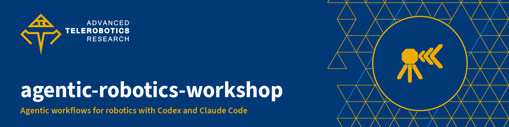
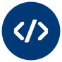
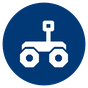

**Workshop material for using coding agents to make small, understood and verified changes to robotics software, from a point-cloud bug to a bounded TurtleBot3 simulation.**

<sub>Advanced Telerobotics Research Laboratory · Department of Computer Science · Kent State University</sub>

[](https://www.atr.cs.kent.edu/)


[](#license)

The Advanced Telerobotics Research Laboratory prepared this material for a two-hour workshop at Kent State University on Nov. 7, 2026: a 45-minute talk with live demos, then a one-hour hands-on lab. The emphasis is on specifying, understanding, implementing and verifying software with an agent; ROS 2 supplies a concrete integration problem. Everything runs on a laptop with authored fixtures, an authored synthetic rosbag and a headless Gazebo simulation. No sensor or robot is needed, and none is operated.

## Start here

<table>
<tr>
<td width="33%" valign="top"><br><b><a href="deliverables/atr-slides-agentic-robotics-2026-11-04-animated.pdf">Slides</a></b><br>The 25-slide deck as a PDF, with the <a href="docs/slides.md">slide manuscript</a> and <a href="docs/talk-outline.md">talk outline</a>.</td>
<td width="33%" valign="top"><br><b><a href="docs/lab-commands.md">Hands-on lab</a></b><br>Six scripted steps, with the commands for macOS, Linux and Windows and the common fixes.</td>
<td width="33%" valign="top"><br><b><a href="docs/participant-workbook.md">Participant workbook</a></b><br>The point-cloud exercise, its contract and the explain-back questions.</td>
</tr>
<tr>
<td valign="top"><br><b><a href="docs/working-demos.md">ROS 2 demos</a></b><br>The synthetic rosbag replay and the bounded TurtleBot3 application in headless Gazebo.</td>
<td valign="top"><br><b><a href="docs/facilitator-guide.md">Run the workshop</a></b><br>Facilitator guide, <a href="docs/setup.md">setup</a> and a <a href="docs/rehearsal.md">rehearsal plan</a>.</td>
<td valign="top"><br><b><a href="docs/verification.md">Evidence</a></b><br>What ran, where, with which versions, and what has not been tested.</td>
</tr>
</table>

## Try it

The core exercise needs only Python 3.9 or newer. From this folder:

```bash
python3 -I exercises/check.py --solution
python3 -I exercises/check.py
```

The reference solution passes 12 of 12 checks; the starter fails two on purpose until you fix it. The lab runs the same exercise one step at a time, with a `doctor` check for every step:

```bash
bash lab/00-check.sh
bash lab/01-reproduce.sh
```

On Windows without Bash, use `py -3 lab\lab.py 00` (any step number). Steps 03 and 04 run ROS 2 Jazzy and Gazebo in a container on any computer with Docker, x86-64 or arm64:

```bash
docker pull ghcr.io/atr-lab/agentic-workshop-station:2026.11
bash lab/03-replay.sh
bash lab/04-simulate.sh
```

If the image cannot be pulled, build it from this folder with `docker build -t ghcr.io/atr-lab/agentic-workshop-station:2026.11 -f lab/docker/Dockerfile .` (about 10 minutes). The [command sheet](docs/lab-commands.md) covers every operating system and the problems people hit most.

## What's inside

| Folder | Contents |
|---|---|
| [`docs/`](docs/start-here.md) | Start page, slide manuscript, talk outline, workbook, facilitator guide, setup, rehearsal, prompt cards, answer key and verification |
| [`lab/`](lab/README.md) | The six lab step scripts (`run`, `doctor`, `help`), standard-library Python, and the Docker station image |
| `exercises/`, `solutions/` | The deliberately incorrect starter, its checker and the reference solution |
| [`ros2/agentic_workshop`](ros2/agentic_workshop) | ROS 2 package: point-cloud diagnostic node, synthetic replay runner and the bounded TurtleBot3 controller, command guard and scenario checker |
| [`skills/`](skills) | Four agent skills for Codex and Claude Code; `.agents/skills` and `.claude/skills` link to them |
| `templates/` | Interface contract and run report |
| [`evidence/`](evidence) | Saved reports and environment records from Nov. 3–5, 2026 |
| `scripts/` | Setup for an Ubuntu 24.04 ROS 2 station, and a fresh practice copy of this folder |

## Use it with an agent

Open this folder in your agent, read `AGENTS.md`, then ask it to use the relevant skill. An explicit path such as `skills/unilidar-replay/SKILL.md` works even when the client does not discover skills on its own.

| Skill | Example request | Output |
|---|---|---|
| `robotics-orient` | "Use this skill to scope the UniLiDAR exercise in my ROS workspace." | Environment inventory, interface contract, acceptance checks |
| `explain-robotics-pr` | "Help me understand this PR before deciding whether it is ready." | Code-grounded explanation and unresolved questions |
| `unilidar-replay` | "Build and verify a diagnostic sector-clearance node from this recording." | Bounded implementation, reproducible replay, evidence report |
| `turtlebot-capstone` | "Implement the workshop's TurtleBot3 stop-before-obstacle application in simulation." | Complete application, launch and configuration, scenario checks, run report |

## What this does and does not show

The replay uses an authored synthetic PointCloud2 bag, not a capture from Unitree hardware, and the capstone runs a simulated TurtleBot3 Burger in headless Gazebo. Results establish the simulated configuration only. A physical trial needs a prepared area, a verified stop path and separate approval, and the agent stays outside the real-time control loop. See [verification](docs/verification.md) for exactly what ran.

## License

Source code and scripts (`lab/`, `exercises/`, `solutions/`, `ros2/`, `scripts/`) are under the [MIT License](LICENSE). Documentation, skills, templates, slides and evidence write-ups are under [Creative Commons Attribution 4.0](LICENSE-docs.md). The Advanced Telerobotics Research Laboratory and Kent State University names and logos are not covered by either license.

---

[About the lab](https://github.com/ATR-Lab/about) · [Getting started in the ATR Lab](https://github.com/ATR-Lab/getting-started-atr-lab) · [Development guidelines](https://github.com/ATR-Lab/dev-guidelines) · [All repositories](https://github.com/orgs/ATR-Lab/repositories)

<sub>Advanced Telerobotics Research Laboratory · Department of Computer Science · Kent State University · [www.atr.cs.kent.edu](https://www.atr.cs.kent.edu/)</sub>
